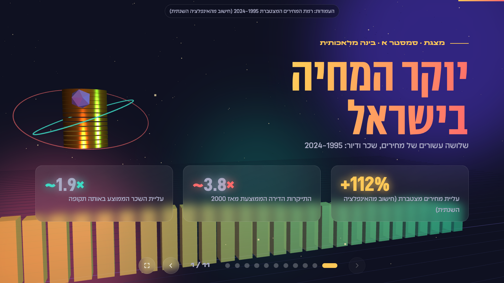
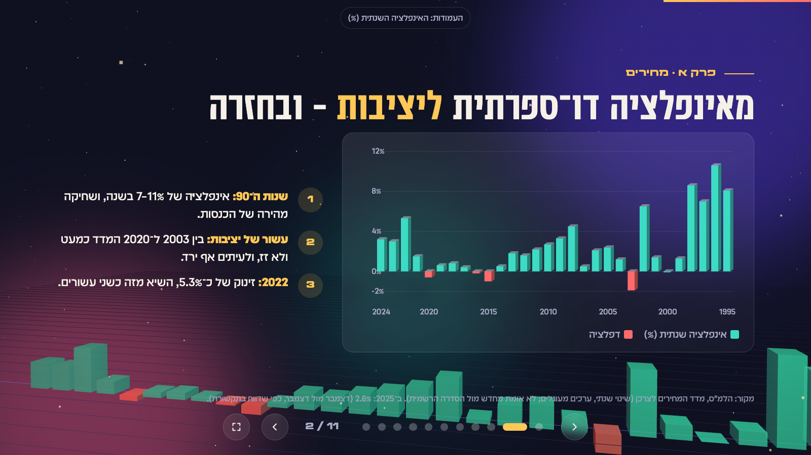
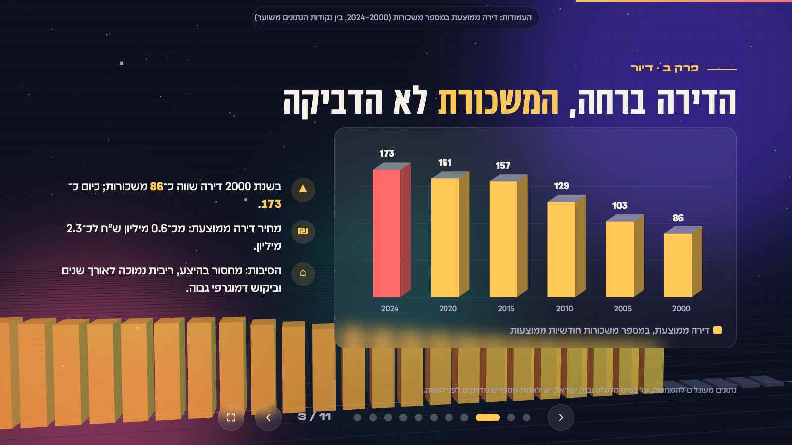
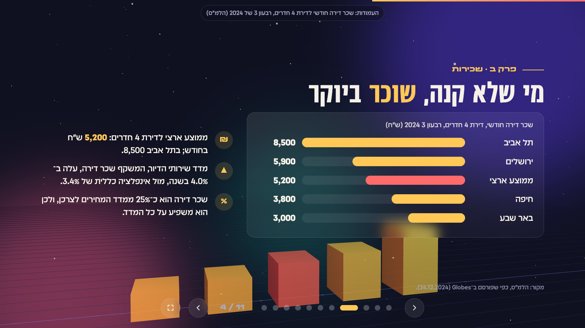
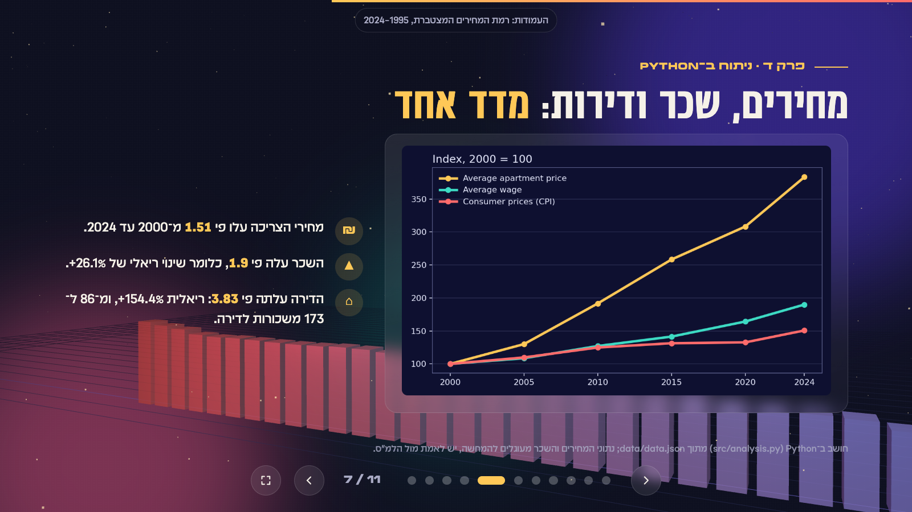
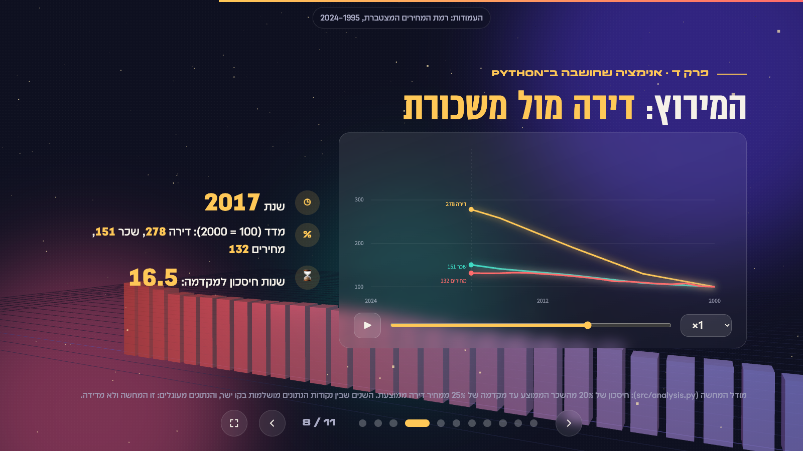
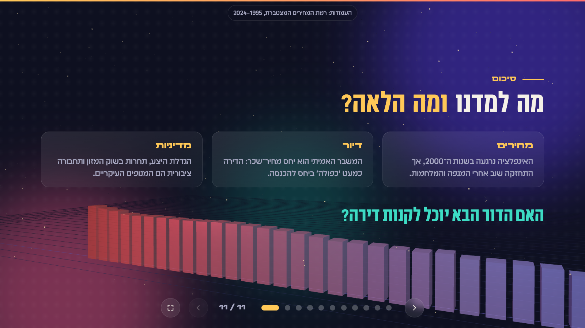
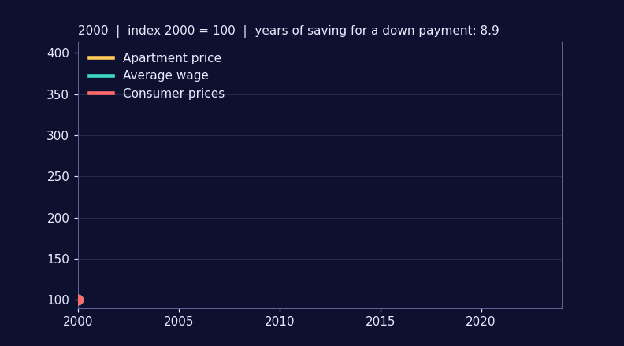

# Cost of Living in Israel, 1995–2024

An interactive Hebrew (RTL) presentation: thirty years of prices, wages and housing costs in Israel, in a single HTML file with a Three.js 3D scene, JavaScript navigation, and slides produced by Python.

**Open it:** download the repository and double-click `index.html` (no server, no network needed).

| | |
|---|---|
|  |  |
| 1 · Title and three headline numbers | 2 · Annual inflation, 3D bars |
|  |  |
| 3 · Apartment price in average salaries: 86 → 173 | 4 · Rents by city (CBS via Globes) |
|  |  |
| 5 · Where the monthly budget goes (CBS 2023) | 6 · Top vs bottom income decile (CBS 2023) |
|  |  |
| 7 · **Python analysis**, index 2000 = 100 | 8 · **Animated race** (Python data, JS canvas) |
|  |  |
| 9 · Israel vs OECD, wages vs prices | 10 · Possible levers (for discussion) |
|  |  |
| 11 · Summary | The same race as an animated GIF, generated by `src/analysis.py` |

## The finding
Between 2000 and 2024 consumer prices rose about 1.5×, the average wage 1.9× and the average apartment 3.8×. In real terms wages gained roughly 26% while apartment prices gained about 154%, so the number of average salaries needed to buy an apartment doubled (86 → 173).

## How the requirements are met
- **JavaScript:** previous/next buttons, progress dots, keyboard (← forward in RTL), `#3` deep links, `?auto` auto-play.
- **Three.js (3D):** a "data city" of 30 instanced columns that morphs between eight datasets as slides change (cumulative prices, inflation, apartment price in salaries, spending shares, rent by city, owners vs renters, international gaps), with per-slide camera moves, a coin-rain burst on every slide change, and a floating coin tower with rings on the title slide.
- **Python:** `src/analysis.py` reads `data/data.json`, computes the indices and draws `docs/charts/index_2000.png`; `src/build.py` generates slides 4, 6, 7, 8, 9 and 10 from `data/data.json` and the analysis output (bar rows, the indices chart, the computed numbers). Slide 8 is an interactive animation: Python computes yearly series and a savings model (`build/race.json`), and a canvas player (`src/race.js`) draws it with play/pause, a year scrubber and speed control; the same series is exported as `docs/charts/race.gif`. Slides 1–3, 5 and 11 are the original hand-written deck, with the spending data updated.
- **Single file:** Three.js and the fonts are embedded in `index.html`. The same fonts are also stored in `fonts/` (see `fonts/README.md` for licensing notes).

## Regenerate the Python slide
```bash
python3 -m venv .venv && .venv/bin/pip install -r requirements.txt
.venv/bin/python src/analysis.py
.venv/bin/python src/build.py
```

## Repository layout
```
index.html          the presentation (open this)
PRD.md              product requirements document
prompts/            the prompts given to the LLM, per stage
src/                analysis.py (stats + chart), build.py (inject slide)
data/data.json      the figures used
docs/               screenshots and generated chart
fonts/              extracted .ttf files
```

## Process and critical review
Work was led through Claude Code in the terminal: requirements first (PRD), then an audit of the existing deck against the assignment, then Python integration, then verification by serving the page, screenshotting every slide, and reading the browser console. The prompts are in [`prompts/`](prompts/README.md).

What I corrected along the way: a BiDi bug that rendered `+26.1%` as `%26.1+`, a stale slide counter after adding a slide, and screenshots captured mid-transition.

Known limitations:
- **Official, read in full:** the CBS Household Expenditure Survey 2023 (published 2026-01-01): spending shares (slide 5) and income-decile figures (slide 6). CBS notes that 2023 income measurement changed, so these are not comparable with earlier years.
- **Taken from press reports of CBS / OECD / Ministry of Economy data** (Globes, Times of Israel): rents by city (Q3 2024), housing-services index, OECD price-level and food comparisons (the food figure is from 2017 data), 2024 wage growth. The article dates and sources are on each slide.
- **Rounded, illustrative and not re-verified:** the annual inflation series 1995–2024 and the apartment price / average wage points used in slides 2, 3 and 7. Verify against cbs.gov.il before citing.
- The Python chart uses English labels to avoid RTL shaping issues in matplotlib.
- The savings model on slide 8 is illustrative: 20% of the average wage saved towards a 25% down payment; the years between the six price/wage data points are linearly interpolated.
- A syntax error in the 3D script (an unescaped quote) was introduced in commit `29fe765` and fixed in the next push; between those pushes the 3D scene did not load and only the CSS fallback was shown. I caught it by running `node --check` on every inline script and by looking at the screenshots again.
- Only the Assistant font is clearly open-licensed; check the others before reuse.
- Slides 1–3, 5 and 10 and the Three.js scene come from an earlier session (28/10/2026); its prompts are in [`prompts/00-original-deck-session.md`](prompts/00-original-deck-session.md). The assistant's replies in that session are not archived here.

## Authors
Yaakov Geppert and Yoav Haramaty (group `biu-yayo`, exercise 01).
